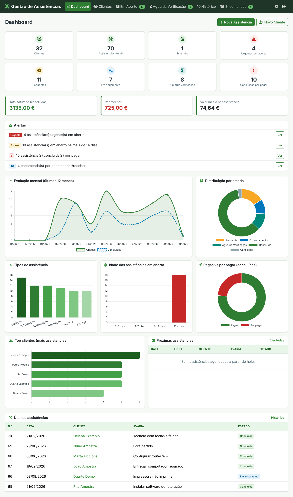
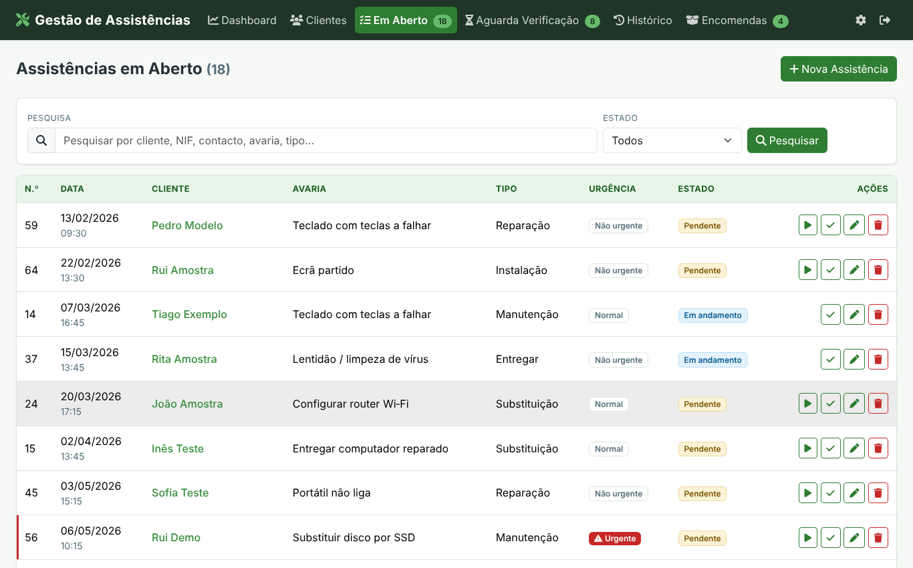
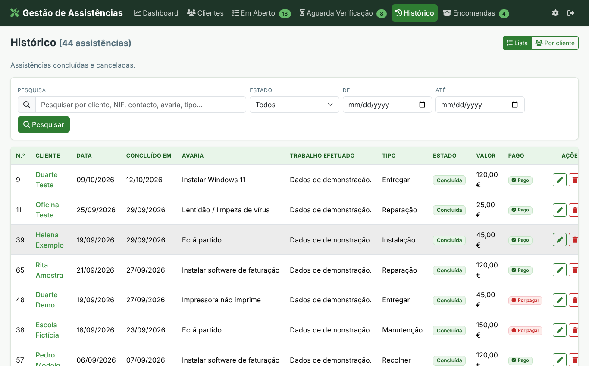
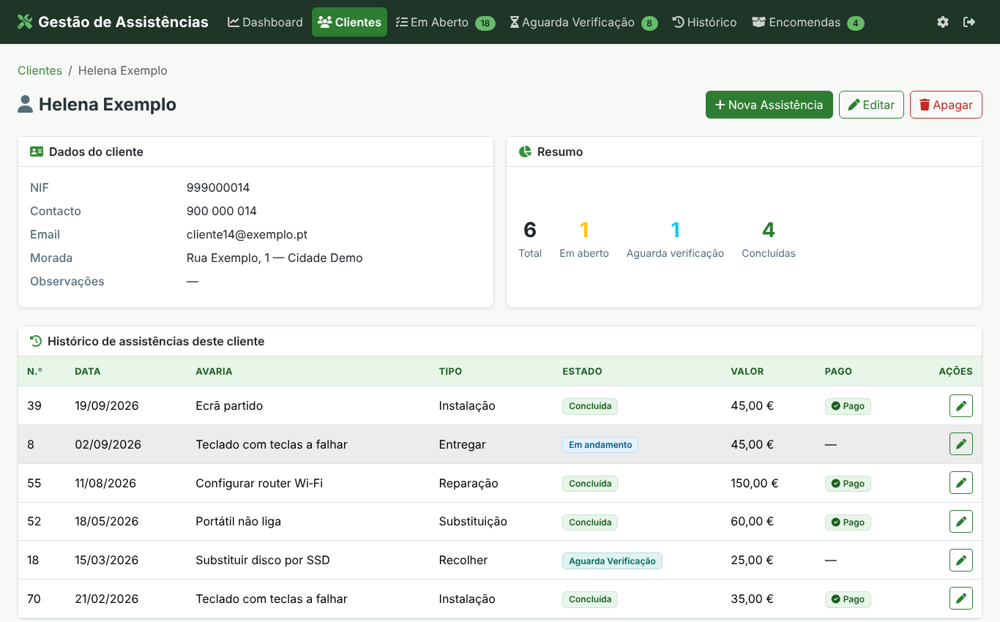
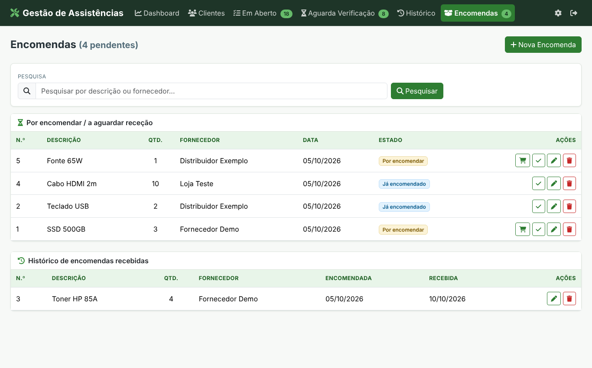
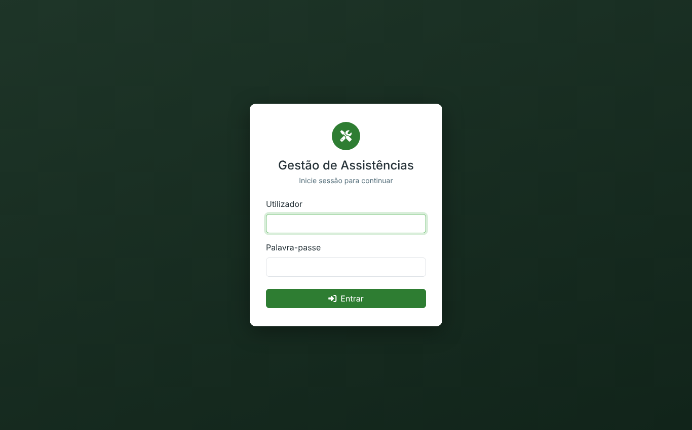
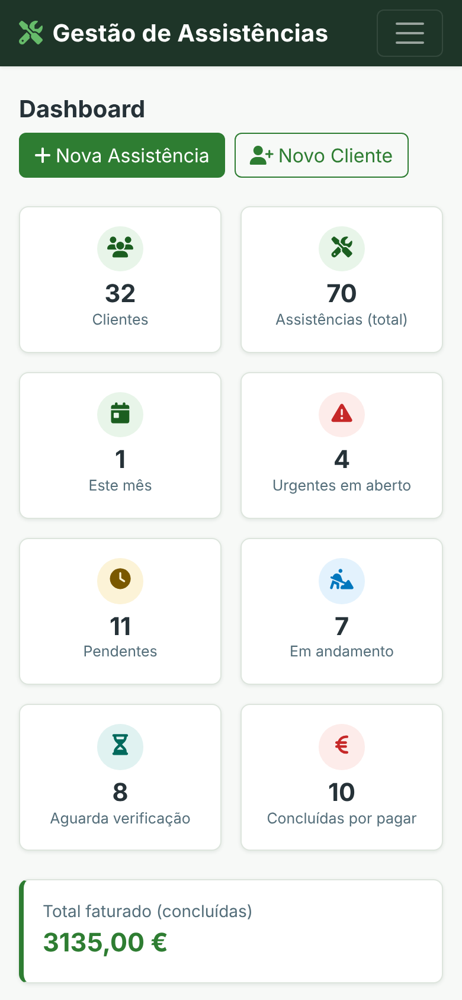

# Repair Service Manager (Gestão de Assistências)

A self-hosted web app for small IT repair shops to manage clients, service jobs, parts orders and payments from one dashboard. I built it for my own day-to-day work as an IT technician, and it runs in production with real data. It later became the inspiration for **[Ruvylo](https://ruvylo.com)**, the SaaS platform I founded.

> **Personal project, designed and developed by me.** The interface is in Portuguese. All screenshots use fictitious demo data.



## Features

- **Service job workflow:** Pending → In progress → Awaiting verification → Completed (or Cancelled), with urgency levels, service types and payment tracking
- **Clients:** search, detail page with full job history, and protection against deleting clients that have jobs
- **Dashboard:** summary cards, alerts (urgent, overdue, unpaid, pending orders) and 6 charts (status, monthly trend, job types, age of open jobs, paid vs unpaid, top clients)
- **History** in two views: a flat list, or grouped by client with an expandable timeline
- **Parts orders:** To order → Ordered → Received
- Search, date filters and pagination (10/20/50) on every list
- Responsive layout that works on desktop and mobile

## Security

- Login required on every route; passwords hashed with `werkzeug.security`
- CSRF protection on all POST forms, with constant-time token comparison
- Session cookies set to `HttpOnly` and `SameSite=Lax`, with a 12-hour lifetime and `Secure` configurable
- 100% parameterised SQL queries
- Security headers: CSP, `X-Frame-Options`, `X-Content-Type-Options`, `Referrer-Policy`, `Permissions-Policy`
- Warning shown while the default password is still in use
- Optional external access through **Cloudflare Tunnel + Cloudflare Access** (HTTPS, country filter, email one-time code), with no open router ports

## Tech Stack

| Layer | Technology |
|---|---|
| Backend | Python 3.12, Flask |
| Database | SQLite with automatic, additive migrations (backup before each migration) |
| Frontend | Jinja2 templates, Bootstrap 5, Chart.js (served locally) |
| Production server | gunicorn, running in Docker as a non-root user |
| Deployment | Docker Compose (local or production profile) |
| Backups | Daily backup container (SQLite `.backup` + gzip + rotation) and a weekly PowerShell snapshot to an external disk or NAS |
| External access | Cloudflare Tunnel + Access (optional) |

## Getting Started

### Run locally

```bash
git clone https://github.com/MooniePT/repair-service-manager.git
cd repair-service-manager
pip install -r requirements.txt
python app.py
```

Open http://localhost:5000. The first login is `admin` / `admin123`. Change it right away on the **Configuração** page; the app warns you until you do.

### Run with Docker

```bash
docker compose up --build
```

`database/` (data) and `instance/` (secret key) are mounted as volumes, so they survive rebuilds. A second container makes a daily database backup.

### Production with Cloudflare Tunnel

```bash
cp .env.example .env      # set SECRET_KEY and TUNNEL_TOKEN
docker compose -f docker-compose.prod.yml up -d --build
```

The step-by-step guide is in [docs/CLOUDFLARE.md](docs/CLOUDFLARE.md) (Portuguese).

### Environment variables

| Variable | Default | Purpose |
|---|---|---|
| `SECRET_KEY` | generated and stored in `instance/secret_key` | **Set your own in production** |
| `SESSION_COOKIE_SECURE` | `0` | Set to `1` when served over HTTPS |
| `BEHIND_PROXY` | `0` | Set to `1` behind a reverse proxy or tunnel |
| `FLASK_DEBUG` | `0` | Local development only |
| `DATABASE_PATH` | `database/assistencias.db` | Custom database location |

## Screenshots

| Open jobs | History |
|---|---|
|  |  |

| Client detail | Parts orders |
|---|---|
|  |  |

| Login | Mobile |
|---|---|
|  |  |

## Project Structure

```
├── app.py                    # Flask app: routes, data access, validation, security
├── templates/                # Jinja2 pages (+ _macros.html)
├── static/                   # CSS, JS and a local copy of Chart.js
├── Dockerfile                # Web app image (gunicorn, non-root)
├── Dockerfile.backup         # Daily SQLite backup container
├── backup.sh                 # Backup script used by that container
├── docker-compose.yml        # Local setup
├── docker-compose.prod.yml   # Production setup with Cloudflare Tunnel
├── scripts/backup_externo.ps1  # Weekly external snapshot (NAS / second disk)
└── docs/                     # Manual, Cloudflare guide, diagrams, screenshots (Portuguese)
```

`database/`, `instance/` and `.env` are git-ignored. They hold real data and secrets and never leave the server.

## Documentation

- [Application manual](docs/MANUAL.md): setup, Docker, backups, migration
- [Cloudflare guide](docs/CLOUDFLARE.md): secure external access
- [Original README (Portuguese)](docs/LEIA-ME.pt.md)

## What I Learned

- Turning a real business need into a working product, then running it in production every day
- Designing safe schema migrations for a live SQLite database
- Securing a web app: CSRF, password hashing, security headers, cookie settings and zero-trust external access
- Packaging and deploying with Docker, and planning layered backups (daily + external)
- Writing documentation that lets someone else reinstall or migrate the system
