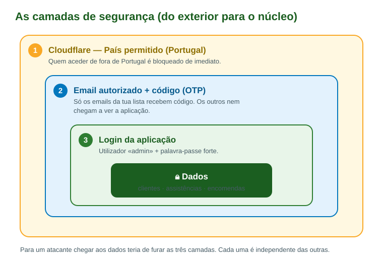
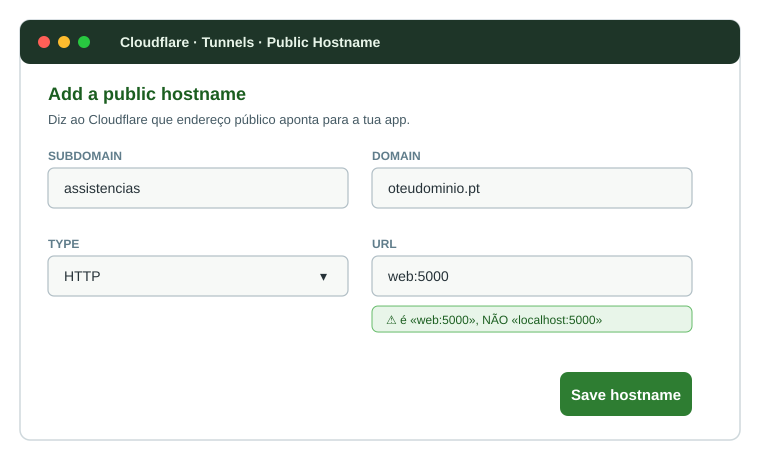
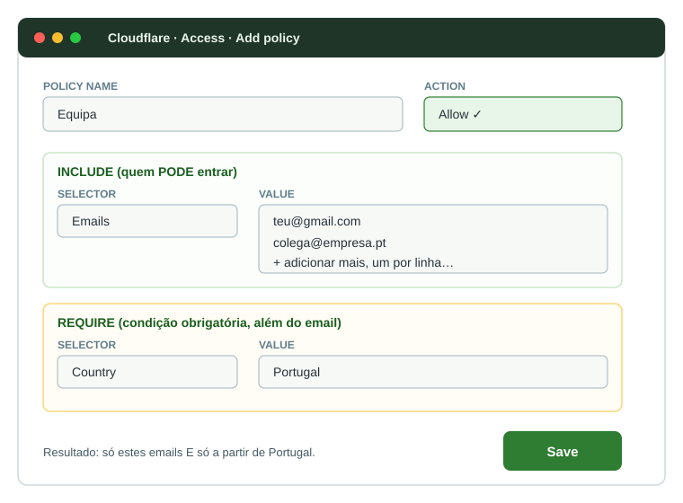

# Guia Cloudflare — Acesso externo seguro

> Como tornar a aplicação acessível de fora (Internet) com **HTTPS**, sem
> abrir portas no router, e protegida por **três camadas**: país, email e
> login da aplicação.

**Índice**
1. [Como funciona (resumo)](#1-como-funciona-resumo)
2. [O domínio no Cloudflare](#2-o-domínio-no-cloudflare)
3. [Criar o Túnel](#3-criar-o-túnel)
4. [Ligar a aplicação ao túnel (Docker)](#4-ligar-a-aplicação-ao-túnel-docker)
5. [Mapear o endereço público](#5-mapear-o-endereço-público)
6. [Proteção por email + país (Cloudflare Access)](#6-proteção-por-email--país-cloudflare-access)
7. [Gestão do dia a dia](#7-gestão-do-dia-a-dia)
8. [Segurança máxima — checklist](#8-segurança-máxima--checklist)
9. [Resolução de problemas](#9-resolução-de-problemas)

---

## 1. Como funciona (resumo)


Quando alguém abre `https://assistencias.oseudominio.pt`:

1. O pedido chega ao **Cloudflare** (não diretamente à sua máquina).
2. O Cloudflare verifica o **país** → só Portugal passa.
3. Verifica o **email** → só os da lista; envia um **código** para o email.
4. Só então o pedido entra pelo **túnel encriptado** até ao contentor Docker.
5. Por fim, a pessoa ainda tem de fazer **login na aplicação**.



**Vantagens:** HTTPS automático, sem abrir portas no router, e a máquina
nunca fica diretamente exposta à Internet.

---

## 2. O domínio no Cloudflare

Precisa de um domínio gerido pelo Cloudflare (plano **Free** chega).

- **Não tem domínio?** Em <https://dash.cloudflare.com> → secção **Registrar** →
  compre um (~10 €/ano). Fica logo configurado no Cloudflare.
- **Já tem domínio noutro registador?** No Cloudflare: **Add a site** → escreva
  o domínio → escolha o plano **Free** → o Cloudflare dá-lhe **2 nameservers**.
  Vá ao painel do registador onde comprou o domínio e substitua os
  nameservers pelos do Cloudflare. (Pode demorar de minutos a algumas horas
  a ficar ativo.)

Quando o domínio aparecer como **Active** no Cloudflare, pode continuar.

---

## 3. Criar o Túnel

O túnel é a "ponte" segura entre o Cloudflare e a sua máquina.

1. Em <https://one.dash.cloudflare.com> (painel **Zero Trust**).
   - Na primeira utilização pode pedir para escolher um plano — escolha o
     **Free** (pode pedir um cartão para ativar a conta, mas não é cobrado).
2. Menu lateral: **Networks → Tunnels** → **Create a tunnel**.
3. Tipo de conector: **Cloudflared** → **Next**.
4. Dê um nome ao túnel, por exemplo `assistencias` → **Save tunnel**.
5. No ecrã "Install and run a connector", escolha o separador **Docker**.
   **Copie apenas o token** — a longa sequência de caracteres a seguir a
   `--token`. **Não** corra o comando que eles mostram (vamos usar o nosso
   compose). Guarde o token num sítio seguro.

> O token é um segredo. É o que autoriza a sua máquina a ligar-se ao túnel.

---

## 4. Ligar a aplicação ao túnel (Docker)

Na pasta do projeto:

### 4.1 Gerar a SECRET_KEY (uma vez)
```powershell
docker run --rm python:3.12-slim python -c "import secrets; print(secrets.token_hex(32))"
```

### 4.2 Criar o ficheiro `.env`
Crie um ficheiro chamado **`.env`** (a partir do `.env.example`) com:
```
SECRET_KEY=cole-aqui-a-chave-gerada-no-passo-4.1
TUNNEL_TOKEN=cole-aqui-o-token-copiado-do-cloudflare
```
> ⚠️ **Importante:** no ficheiro **compose** ficam os *nomes* das variáveis
> (`${SECRET_KEY}`, `${TUNNEL_TOKEN}`). Os *valores* ficam **só** no `.env`.
> Foi exatamente este o erro do "invalid interpolation": pôr o valor onde
> devia estar o nome.

### 4.3 Arrancar com o compose de produção
```powershell
cd C:\Caminho\Para\ProjetoWeb
docker compose -f docker-compose.prod.yml up -d --build
docker compose -f docker-compose.prod.yml logs tunnel --tail 20
```
Nos registos do `tunnel` deve aparecer **`Registered tunnel connection`**.
No painel do Cloudflare, o túnel passa a **HEALTHY**.

---

## 5. Mapear o endereço público

Diz ao Cloudflare que endereço da Internet aponta para a aplicação.



1. **Networks → Tunnels** → abra o seu túnel → separador **Public Hostname**
   → **Add a public hostname**.
2. Preencha:
   - **Subdomain**: `assistencias`
   - **Domain**: `oseudominio.pt`
   - **Type**: `HTTP`
   - **URL**: `web:5000`  ← é o nome do serviço no Docker, **não** `localhost`
3. **Save hostname**. O registo de DNS é criado automaticamente.

A partir daqui, `https://assistencias.oseudominio.pt` já chega à aplicação
(com HTTPS). Falta só proteger quem pode entrar.

---

## 6. Proteção por email + país (Cloudflare Access)

Esta é a parte que controla **quem** pode aceder. **Só o administrador da
conta Cloudflare** (você) gere esta lista — ninguém entra só por escrever um
email; tem de estar na lista que você define.



### 6.1 Criar a aplicação protegida
1. Painel **Zero Trust** → **Access → Applications** → **Add an application**.
2. Tipo: **Self-hosted**.
3. Preencha:
   - **Application name**: `Gestao de Assistencias`
   - **Session Duration**: `24 hours` (quanto tempo fica autenticado sem
     repetir o código)
   - **Application domain / Public hostname**: `assistencias` + `oseudominio.pt`
     — **tem de ser o mesmo endereço** do passo 5.
4. **Next**.

### 6.2 Criar a política (emails autorizados + país)
No passo das **Policies** (dentro do assistente; em alguns painéis é uma
secção à parte chamada **Access → Policies** — os campos são os mesmos):

1. **Policy name**: `Equipa`
2. **Action**: `Allow`
3. **Include** (quem **pode** entrar):
   - **Selector**: `Emails`
   - **Value**: escreva cada email autorizado, ex.:
     `voce@gmail.com`, `colega@empresa.pt`
   - Esta lista é a chave: **só** estes emails recebem código.
4. **Require** (condição **obrigatória**, além do email) — o bloqueio por país:
   - clique em **Add require**
   - **Selector**: `Country`
   - **Value**: `Portugal`
   - Assim, mesmo um email da lista só entra **a partir de Portugal**.
5. Guardar a política → **Next** → **Add application**.

> **Include** vs **Require**:
> - **Include** = "basta cumprir uma destas" (a lista de emails).
> - **Require** = "tem de cumprir SEMPRE esta" (estar em Portugal).
> Resultado combinado: **email na lista E em Portugal**.

### 6.3 Método de login por email
O envio do código por email (**One-time PIN**) vem **ativo por defeito** —
não precisa de configurar nada. (Fica em **Settings → Authentication**, caso
queira confirmar; o nome do menu varia entre versões do painel.)

### 6.4 Testar
1. Em **janela anónima** ou no **telemóvel com dados móveis**, abra
   `https://assistencias.oseudominio.pt`.
2. Aparece o ecrã do Cloudflare a pedir o email.
3. **Teste positivo:** email da lista → recebe código no email → introduz →
   vê o login da aplicação. ✅
4. **Teste negativo:** email **fora** da lista → acesso negado, sem código. ❌

---

## 7. Gestão do dia a dia

**Onde:** Zero Trust → **Access → Applications → Gestao de Assistencias →
Policies → Equipa**.

| Quero… | Como |
|---|---|
| Autorizar uma pessoa | Edite a política, acrescente o email em **Include → Emails**, **Save**. Efeito imediato. |
| Remover uma pessoa | Tire o email da lista e **Save**. |
| Cortar acesso já (mesmo com sessão aberta) | Remova o email **e** em **Applications → (a app) → ⋯ → Revoke existing tokens**. |
| Ver quem entrou / tentativas recusadas | Zero Trust → **Logs → Access**. |
| Mudar o tempo de sessão | Na aplicação → **Session Duration**. |

---

## 8. Segurança máxima — checklist

Por ordem de impacto:

- [ ] **2FA na conta Cloudflare** — é a conta que controla tudo. Painel normal
      do Cloudflare → **My Profile → Authentication → Two-Factor**.
- [ ] **Palavra-passe forte no login da app** (mudar a `admin123` em ⚙).
- [ ] **Require Country = Portugal** na política (passo 6.2). ✅ já ativado.
- [ ] **Lista de emails individuais e nominais** (evitar regras tipo "qualquer
      @gmail.com"); remover quem sair da equipa.
- [ ] **Renovar o token do túnel** se alguma vez foi exposto: Networks →
      Tunnels → o túnel → **⋯ → Refresh token** → atualizar o `.env` →
      `docker compose -f docker-compose.prod.yml up -d`.
- [ ] **`SESSION_COOKIE_SECURE=1`, `BEHIND_PROXY=1`, `SECRET_KEY` própria** no
      modo externo (já vêm no `docker-compose.prod.yml`).
- [ ] **Porta em `127.0.0.1`** no compose de produção (já configurado) — a app
      não fica exposta diretamente, só pelo túnel.
- [ ] **Backups regulares** de `database/assistencias.db` e do `.env`.

Com país + email + login, são **3 barreiras independentes** entre a Internet
e os seus dados.

---

## 9. Resolução de problemas

| Sintoma | Causa | Solução |
|---|---|---|
| Túnel não fica **HEALTHY** | Token errado/expirado | `docker compose -f docker-compose.prod.yml logs tunnel`; renovar token (passo 8) e atualizar `.env`. |
| Site dá **502 Bad Gateway** | URL do hostname errado | No passo 5, **URL** tem de ser `web:5000` (não `localhost`). |
| Site **não abre** / DNS | Hostname/domínio não propagado | Confirme que o domínio está **Active** no Cloudflare e o hostname criado. |
| Recebo código mas depois **não entra na app** | Cookies inseguros | Confirme `SESSION_COOKIE_SECURE=1` e `BEHIND_PROXY=1` no compose de produção. |
| Email **da lista** é recusado | Está fora de Portugal, ou a política tem o email mal escrito | Verifique o **Require Country** e a lista de emails. Veja **Logs → Access**. |
| Quero **desligar** o acesso externo | — | `docker compose -f docker-compose.prod.yml down` e volte ao `docker compose up -d` local. A app continua a funcionar em `http://localhost:5000`. |

---

### Lembrete final
O ficheiro **`.env`** (com `SECRET_KEY` e `TUNNEL_TOKEN`) e a conta
**Cloudflare** são as "chaves do reino". Guarde-os bem e nunca os partilhe.
Para revogar todo o acesso externo de uma vez, basta **apagar o túnel** no
painel do Cloudflare — a aplicação continua a funcionar localmente.
