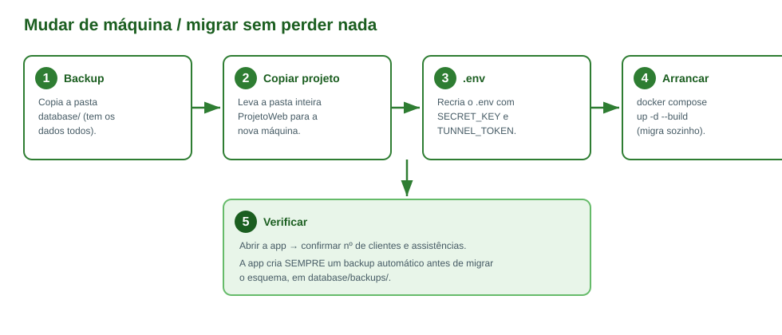
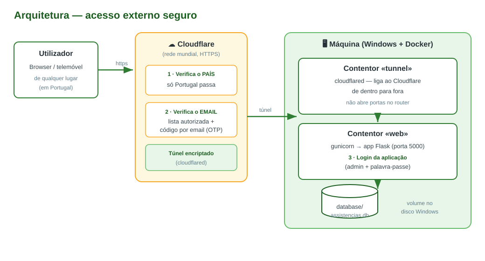

# Manual da Aplicação — Gestão de Assistências

> Documento de referência. Se um dia precisar de reinstalar, mudar de
> computador ou pedir ajuda a outra pessoa, está aqui tudo o que é preciso.

**Índice**
1. [O que é e o que faz](#1-o-que-é-e-o-que-faz)
2. [Como está construída (visão técnica)](#2-como-está-construída-visão-técnica)
3. [Estrutura de ficheiros](#3-estrutura-de-ficheiros)
4. [Configuração (variáveis de ambiente)](#4-configuração-variáveis-de-ambiente)
5. [Pôr a correr no Docker](#5-pôr-a-correr-no-docker)
6. [A base de dados](#6-a-base-de-dados)
7. [Backups](#7-backups)
8. [Mudar de máquina / migrar sem perder nada](#8-mudar-de-máquina--migrar-sem-perder-nada)
9. [Tarefas do dia a dia](#9-tarefas-do-dia-a-dia)
10. [Resolução de problemas](#10-resolução-de-problemas)
11. [Acesso externo (Cloudflare)](#11-acesso-externo-cloudflare)

---

## 1. O que é e o que faz

Aplicação web para gerir as assistências técnicas e os clientes de uma
pequena empresa. Funciona num browser (computador ou telemóvel).

**Funcionalidades:**
- **Clientes** — lista, pesquisa, ficha individual com histórico, criação/edição. Não deixa apagar um cliente que tenha assistências associadas (evita perder histórico).
- **Assistências** — fluxo de estados:
  `Pendente → Em andamento → Aguarda Verificação → Concluída` (ou `Cancelada`).
- **Em Aberto / Aguarda Verificação / Histórico** — cada lista mostra só as assistências no estado certo.
- **Histórico** — com duas vistas: lista normal, ou **agrupado por cliente** (clica-se no cliente para abrir todo o histórico dele).
- **Encomendas** — material a encomendar/receber (`Por encomendar → Já encomendado → Recebido`).
- **Dashboard** — cartões de resumo, alertas (urgentes, atrasadas, por pagar, encomendas) e 6 gráficos (estados, evolução mensal, tipos, idade das abertas, pagas vs por pagar, top clientes).
- **Pesquisa** em todas as listas; **paginação** com 10/20/50 por página.
- **Login** com utilizador e palavra-passe.

---

## 2. Como está construída (visão técnica)

| Camada | Tecnologia |
|---|---|
| Linguagem | Python 3.12 |
| Framework web | Flask |
| Servidor de produção | gunicorn |
| Base de dados | SQLite (ficheiro único) |
| Interface | HTML + Bootstrap 5 + Chart.js (servido localmente) |
| Empacotamento | Docker / Docker Compose |
| Acesso externo | Cloudflare Tunnel (opcional) |

Toda a lógica está num único ficheiro, [`app.py`](../app.py): rotas, acesso à
base de dados, validações e segurança (login, CSRF, cabeçalhos).

---

## 3. Estrutura de ficheiros

```
ProjetoWeb/
├── app.py                     ← toda a lógica da aplicação
├── requirements.txt           ← dependências Python
├── Dockerfile                 ← como se constrói a imagem
├── docker-compose.yml         ← arranque LOCAL (sem túnel)
├── docker-compose.prod.yml    ← arranque PRODUÇÃO/EXTERNO (com túnel)
├── Dockerfile.backup          ← contentor de backup automático
├── backup.sh                  ← script de backup diário da BD
├── .env                       ← SEGREDOS (não partilhar!) — criado por si
├── .env.example               ← modelo do .env (sem segredos)
├── .dockerignore / .gitignore
├── templates/                 ← páginas HTML
├── static/                    ← css, javascript, Chart.js
├── database/
│   ├── assistencias.db        ← ★ A BASE DE DADOS (os seus dados)
│   └── backups/               ← cópias de segurança automáticas
├── instance/
│   └── secret_key             ← chave gerada (se não usar SECRET_KEY no .env)
└── docs/                      ← esta documentação
```

O que **realmente** importa preservar: a pasta **`database/`** e o ficheiro
**`.env`**. O resto é código, reconstrói-se.

---

## 4. Configuração (variáveis de ambiente)

Definem-se no `.env` (segredos) e no ficheiro compose (as restantes).

| Variável | Para que serve | Local | Externo (Cloudflare) |
|---|---|---|---|
| `SECRET_KEY` | Protege as sessões. Deve ser fixa e secreta. | opcional¹ | **obrigatória** |
| `SESSION_COOKIE_SECURE` | Cookies só por HTTPS. | `0` | `1` |
| `BEHIND_PROXY` | App confia no túnel/proxy à frente. | `0` | `1` |
| `FLASK_DEBUG` | Modo de depuração. **Nunca `1` em produção.** | `0` | `0` |
| `DATABASE_PATH` | Caminho alternativo da BD (raramente usado). | — | — |
| `TUNNEL_TOKEN` | Token do Cloudflare Tunnel. | — | **obrigatória** |

¹ Se não definir `SECRET_KEY`, a app gera uma e guarda-a em
`instance/secret_key`. Como a pasta `instance/` é um volume, a chave
mantém-se entre reinícios. Mesmo assim, em acesso externo **defina** uma
`SECRET_KEY` própria no `.env`.

---

## 5. Pôr a correr no Docker

Pré-requisito: **Docker Desktop** instalado e a correr.

### 5.1 Modo LOCAL (só nesta máquina)

```powershell
cd C:\Caminho\Para\ProjetoWeb
docker compose up -d --build
```
Aceder em **http://localhost:5000**.

### 5.2 Modo EXTERNO (com Cloudflare)

1. Crie o ficheiro `.env` (copie de `.env.example`) com `SECRET_KEY` e `TUNNEL_TOKEN`.
2. Arranque com o compose de produção:
```powershell
docker compose -f docker-compose.prod.yml up -d --build
```
Detalhes completos do Cloudflare em [CLOUDFLARE.md](CLOUDFLARE.md).

### 5.3 Comandos úteis

```powershell
docker compose ps                 # ver estado dos contentores
docker compose logs -f web        # ver registos da app (Ctrl+C para sair)
docker compose logs -f tunnel     # ver registos do túnel
docker compose down               # parar (NÃO apaga a base de dados)
docker compose up -d --build      # reconstruir e arrancar
docker compose restart web        # reiniciar só a app
```

> ⚠️ **Nunca** use `docker compose down -v`. O `-v` apaga volumes.
> (Mesmo assim, como a BD está numa pasta do disco e não num volume
> anónimo, estaria protegida — mas é boa prática evitar o `-v`.)

### 5.4 Primeiro acesso

- Utilizador: **`admin`**  ·  Palavra-passe inicial: **`admin123`**
- A app avisa no login enquanto esta palavra-passe não for mudada.
- **Mude-a já** no ícone ⚙ (Configuração).

---

## 6. A base de dados

- É **um único ficheiro**: `database/assistencias.db` (formato SQLite).
- A pasta `database/` está montada como **volume** no Docker — ou seja, os
  dados vivem no disco do Windows, **fora** da imagem. Reconstruir a imagem
  (`--build`) **não** toca nos dados.
- Ao arrancar, a app cria tabelas em falta e aplica **migrações aditivas**
  (só acrescenta colunas/normaliza valores, nunca apaga). Antes de qualquer
  alteração de estrutura, **cria automaticamente um backup** em
  `database/backups/`.

### Conteúdo (à data desta documentação)
Tabelas: `clientes`, `assistencias`, `encomendas`, `usuarios`.

---

## 7. Backups

A regra de ouro: **fazer cópia do ficheiro `database/assistencias.db`**.

### Backup manual (rápido)
```powershell
Copy-Item C:\Caminho\Para\ProjetoWeb\database\assistencias.db C:\backup-banco\
```

### Backup com data no nome
```powershell
Copy-Item database\assistencias.db "C:\backup-banco\assistencias-$(Get-Date -Format 'yyyyMMdd').db"
```

### Backup AUTOMÁTICO (contentor dedicado)

O projeto inclui um contentor **`backup`** que faz uma cópia da base de dados
**todos os dias às 03:00** (e também uma assim que arranca). É definido em
[`Dockerfile.backup`](../Dockerfile.backup) + [`backup.sh`](../backup.sh) e já
está incluído nos dois ficheiros compose.

- **Onde ficam as cópias:** `database/backups/auto/` (no disco do Windows),
  com nome `assistencias-AAAAMMDD-HHMMSS.db.gz` (comprimidas).
- **Cópia segura:** usa o `.backup` do SQLite, que produz uma cópia íntegra
  mesmo com a aplicação a escrever ao mesmo tempo.
- **Rotação:** apaga sozinho as cópias com mais de **30 dias** (configurável
  na variável `RETENCAO_DIAS` no compose).

Para o ativar, basta (re)construir os contentores:
```powershell
docker compose -f docker-compose.prod.yml up -d --build   # produção
# ou, em local:  docker compose up -d --build
```
Confirmar que está a correr e ver o registo:
```powershell
docker compose -f docker-compose.prod.yml logs backup --tail 20
```

**Mudar a frequência** (ex.: semanal, domingos às 3h): edite a linha do cron
em `Dockerfile.backup` — `0 3 * * *` (diário) para `0 3 * * 0` (domingos) — e
reconstrua. **Mudar para quantos dias guardar:** altere `RETENCAO_DIAS` no
compose.

### Restaurar a partir de um backup
```powershell
# 1. parar a app
docker compose -f docker-compose.prod.yml down
# 2. descomprimir a cópia escolhida para o lugar da BD ativa
cd C:\Caminho\Para\ProjetoWeb\database
# (no Windows, clique direito no .gz e extraia, ou use o 7-Zip)
#   renomeie o ficheiro extraído para "assistencias.db"
# 3. arrancar de novo
cd ..
docker compose -f docker-compose.prod.yml up -d --build
```

### Backup EXTERNO (semanal, para NAS / 2º disco)

Para proteção contra avaria/roubo da máquina, há um script PowerShell que
leva uma snapshot para **fora** da máquina: [`scripts/backup_externo.ps1`](../scripts/backup_externo.ps1).

- Copia a base de dados (a cópia `.gz` consistente já feita pelo backup
  diário — **sem parar a aplicação**), o **código** e o **`.env`**.
- Envia para **vários destinos** (ex.: 2º disco local + NAS) e mantém as
  últimas **6** snapshots em cada um.
- Configuração no topo do ficheiro: `$Projeto`, `$Container`, `$Destinos`,
  `$Retencao`, `$IncluirImagem`.

> ⚠️ O ficheiro deve ser guardado em **UTF-8 com BOM** (para o PowerShell 5.1
> ler bem os acentos). Confirme os valores de `$Projeto` e `$Container`
> (`docker ps`) antes do primeiro uso.

**Agendar (Task Scheduler), ex.: domingos às 2h:**
```powershell
$acao    = New-ScheduledTaskAction -Execute 'powershell.exe' `
  -Argument '-ExecutionPolicy Bypass -File "C:\Caminho\Para\ProjetoWeb\scripts\backup_externo.ps1"'
$gatilho = New-ScheduledTaskTrigger -Weekly -DaysOfWeek Sunday -At 2:00AM
Register-ScheduledTask -TaskName 'BackupProjetoWeb' -Action $acao -Trigger $gatilho -RunLevel Highest
```

### As três camadas de backup (resumo)
1. **Migração** — automático, antes de a app mudar o esquema → `database/backups/`.
2. **Diário interno** — contentor `backup`, todos os dias → `database/backups/auto/`.
3. **Semanal externo** — script PowerShell → NAS + 2º disco (fora da máquina).
- Guarde também uma cópia do ficheiro **`.env`** num sítio seguro (gestor de
  palavras-passe). Sem ele perde a `SECRET_KEY` e o `TUNNEL_TOKEN`.
- A pasta `database/backups/` também guarda os backups das **migrações**
  (feitos pela app antes de alterar o esquema).

---

## 8. Mudar de máquina / migrar sem perder nada



1. **Backup**: copie a pasta `database/` (e o `.env`) para um sítio seguro.
2. **Copiar o projeto**: leve a pasta inteira `ProjetoWeb` para a nova máquina
   (com a pasta `database/` lá dentro).
3. **`.env`**: recrie o `.env` com a `SECRET_KEY` e o `TUNNEL_TOKEN` (ou copie
   o original).
4. **Arrancar**: `docker compose up -d --build` (local) ou
   `docker compose -f docker-compose.prod.yml up -d --build` (externo).
   A app adapta o esquema sozinha e cria backup antes.
5. **Verificar**: abra a app e confirme o número de clientes e assistências
   no Dashboard.

> Se tiver duas bases de dados e não souber qual é a mais recente, **não
> apague nenhuma**. Abra cada uma e compare as datas das últimas
> assistências — ou peça ajuda antes de substituir.

---

## 9. Tarefas do dia a dia

| Quero… | Onde |
|---|---|
| Mudar a palavra-passe | ⚙ Configuração |
| Criar cliente | Clientes → «Novo Cliente» |
| Criar assistência | Em Aberto → «Nova Assistência» (ou a partir da ficha do cliente) |
| Marcar trabalho feito | botão ✓ na lista «Em Aberto» |
| Aprovar / marcar paga | página «Aguarda Verificação» |
| Ver histórico de um cliente | Histórico → «Por cliente», ou ficha do cliente |
| Gerir material | «Encomendas» |

---

## 10. Resolução de problemas

| Sintoma | Causa provável | Solução |
|---|---|---|
| `invalid interpolation format … ${...}` | Pôs a chave diretamente no compose em vez do nome | No compose fica `${SECRET_KEY}`; o valor vai no `.env`. |
| Não consigo fazer login externamente | `SESSION_COOKIE_SECURE=1` sem HTTPS | Em acesso externo tem de haver HTTPS (Cloudflare). Localmente use `0`. |
| Porta 5000 ocupada | Outro processo/contentor a usar a porta | `docker compose down` no projeto antigo; ou ver quem a usa. |
| App «desatualizada» no browser | Cache | Recarregar com Ctrl+F5. |
| O túnel não liga | Token errado/expirado | Ver `docker compose logs tunnel`; renovar token no Cloudflare. |
| Quero ver o que se passa | — | `docker compose logs -f web` |

### Rollback (voltar a só-local)
Se o acesso externo causar problemas, volte ao modo local sem perder dados:
```powershell
docker compose -f docker-compose.prod.yml down
docker compose up -d --build
```

---

## 11. Acesso externo (Cloudflare)

Toda a configuração de domínio, túnel, autorização por email e bloqueio por
país está no guia dedicado: **[CLOUDFLARE.md](CLOUDFLARE.md)**.


